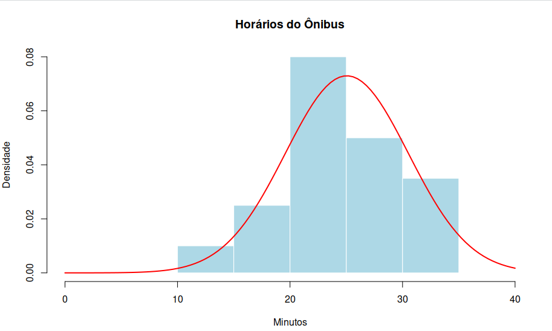

# Análise Estatística de Tempos de Espera de Ônibus

Este repositório contém um script em linguagem R desenvolvido para realizar a análise estatística descritiva e a representação gráfica de uma amostra de tempos de espera de ônibus (em minutos). O ônibus em questão é o que utilizo algumas vezes para voltar da faculdade, mas o horário é incostante podendo passar das 22:11 até 22:34.

## Histograma

## Descrição do Script

O script executa as seguintes etapas metodológicas:
1. **Entrada de Dados:** Armazenamento do vetor de observações (`horaOnibus`).
2. **Ordenação:** Organização dos valores em ordem crescente para visualização da distribuição bruta.
3. **Estatística Descritiva:**
   - **Tamanho da amostra ($n$):** Contagem total de observações.
   - **Mínimo e Máximo:** Identificação dos limites inferior e superior da amostra.
   - **Média Aritmética:** Tendência central dos dados.
   - **Mediana:** Valor central que divide a amostra ordenada.
   - **Moda:** Valor com maior frequência de ocorrência na amostra.
   - **Desvio Padrão:** Medida de dispersão dos dados em relação à média.
4. **Visualização Gráfica:**
   - Construção de um histograma de densidade com intervalos de classe de 5 minutos (escala de 0 a 40 minutos).
   - Sobreposição de uma curva de densidade normal teórica (baseada na média e no desvio padrão amostrais) para avaliação visual da aderência à distribuição normal.

## Requisitos de Execução

Para executar este script, é necessário ter o ambiente **R** instalado em sua máquina. O código utiliza apenas funções nativas do R base, não exigindo a instalação de pacotes externos.

## Como Utilizar

Copie o código fornecido, abra sua interface do R ou RStudio, cole-o no console ou em um script (`.script.R`) e execute-o para obter os valores estatísticos calculados e a plotagem gráfica correspondente.
